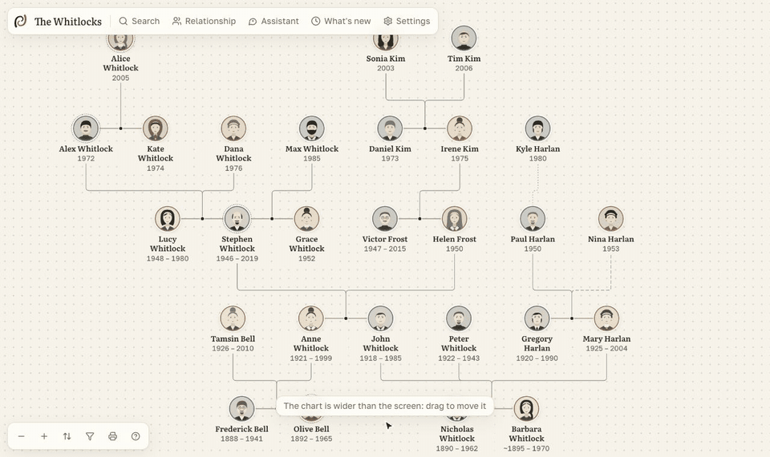
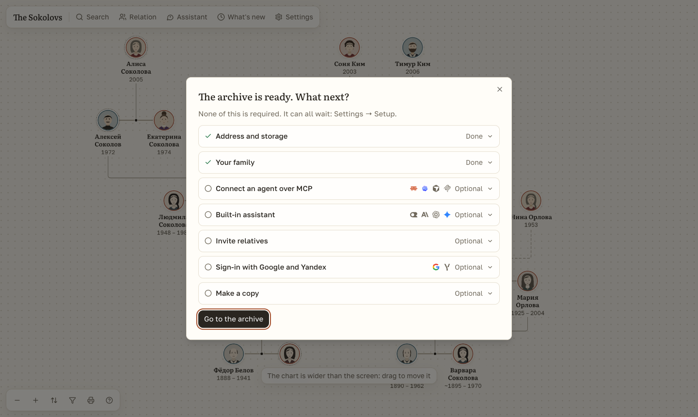
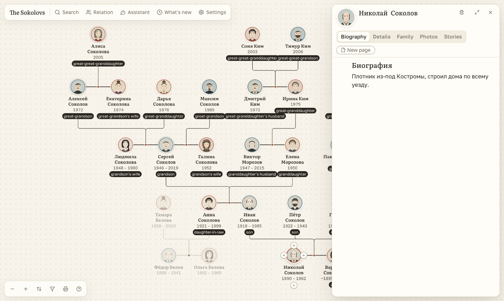

<p align="center">
  <picture>
    <source media="(prefers-color-scheme: dark)" srcset="docs/brand/logo-dark.svg">
    
  </picture>
</p>

# Folkbranch

**A self-hosted family tree your whole family can actually use, and your AI agents can safely edit.**

Build the tree together, give every relative a page with photos and stories, and keep it all on your own server. Free and open source.

[](https://github.com/danarkhipov/folkbranch/actions/workflows/ci.yml) [](https://github.com/danarkhipov/folkbranch/releases) [](LICENSE)

[Install](#install) · [Features](#features) · [Compare](#how-it-compares) · [AI agents](#connect-an-ai-agent) · [FAQ](#faq) · [Docs](docs/SELF_HOSTING.md) · [На русском](README.ru.md)



## Install

Run one command. On a Mac or Linux it needs nothing else: no Docker, and no Node either, it brings its own if you have none.

```bash
curl -fsSL https://raw.githubusercontent.com/danarkhipov/folkbranch/main/install.sh | sh
```

It downloads the app (21 MB, or about 46 MB with Node, and about 120 or 240 MB on disk), starts it and prints a link. Open it, name your family, and load the demo family if you want to look around first. The app then shows what is set up and what is optional.

On a server with a domain, with Docker and automatic HTTPS (a 115 MB image):

```bash
curl -fsSL https://raw.githubusercontent.com/danarkhipov/folkbranch/main/install.sh | sh -s -- --domain family.example.com
```

In Claude Code, install the plugin, then ask it to install Folkbranch:

```
/plugin marketplace add danarkhipov/folkbranch
/plugin install folkbranch@folkbranch
```

Or tell Codex or another agent:

> Install Folkbranch following https://raw.githubusercontent.com/danarkhipov/folkbranch/main/skills/folkbranch/SKILL.md

Backups, updates and hosting on Railway are in the [self-hosting guide](docs/SELF_HOSTING.md).



## Features

**The tree**
- All generations on one screen, with relatives labelled from the person you open.
- Add a relative from any side of a card, or drag a line between two people.
- Ask how two people are related, and see the path.
- Save views of a branch, and print the chart to PDF on one sheet or across several.

**A page for every relative**
- A block editor with headings, photos in the text, and links to other relatives.
- Tag people on photos. Record voice stories, or type what someone told you.
- Keep sources and disagreeing versions of a date side by side, so nothing is overwritten.
- Find and merge duplicate cards, with undo.

**For the whole family**
- Invite relatives with a link: no password to remember.
- Bring in a research case from the [ex-USSR kinship skill](https://github.com/DenisSergeevitch/ex-ussr-kinship-research): what was proved goes on the chart, the rest stays a note.
- Send relatives one file with the chart, cards and photos. It opens with no server or account, and the living stay hidden.
- Owner, editor and reader roles. Readers can suggest corrections for you to accept.
- Share a view-only link, with an optional password and an expiry date.
- Works in a browser on a phone or a computer, in English or Russian.

**Smart features, on this device**
- Off until you turn them on, one by one and separately on each device. The app works the same without them.
- Find faces in a photo, and get a suggestion of who it is from faces you already tagged. A name appears only when you confirm it.
- Turn a recorded story into text, in the browser. It uses Chrome's own recognition where the device has it, and a small speech model otherwise.
- Photos and voice stay on the device. Only the models are downloaded, once, and the app does not slow down while they work.

**Your data stays yours**
- One SQLite file and a folder of photos on your server. No telemetry.
- Living relatives are hidden from readers, guests and read-only agents, and this is enforced on the server.
- Import GEDCOM 5.5.1 and 7.0, Excel, CSV, JSON and plain text. Export GEDCOM or a full copy of the archive.
- Every change is in the history and can be undone.

**AI, when you want it**
- A built-in MCP server and REST API, with tokens you can limit, expire and revoke.
- An agent's edits wait for your review unless you decide otherwise.
- An optional assistant in the app, with your own key for OpenRouter, Anthropic, OpenAI or Google.



## How it compares

Folkbranch is for a family building its history together. [Gramps Web](https://www.grampsweb.org/) and [webtrees](https://webtrees.net/) are mature projects with deeper genealogy tools.

| | Folkbranch | Gramps Web | webtrees |
|---|---|---|---|
| Containers to run | 1 | 3 | 2 |
| Memory | about 70 MB idle, 135 MB under load | about 1.5 GB | about 250 MB |
| Database | SQLite, built in | Gramps database, Redis | MySQL or MariaDB |
| Pages about a person | Block editor with photos in the text | Built-in blog | Custom pages |
| AI agents | MCP built in, with review of edits | Assistant built in; MCP from third parties | Not built in |
| DNA tools | No | Built in | Through modules |
| Desktop app sync | No | With Gramps Desktop | No |
| Plugins | No | Few | 100+ modules |
| Languages | 2 | 40+ | 50+ |
| License | AGPL-3.0 | AGPL-3.0 | GPL-3.0 |

Folkbranch's memory was measured on our own installs. The others' figures are from [selfhosting.sh](https://selfhosting.sh/compare/webtrees-vs-gramps-web), February 2026, and may have changed.

**Choose Gramps Web** if you use Gramps Desktop or need DNA tools. **Choose webtrees** if you need its modules, more languages or very large trees. **Choose Folkbranch** if you want one small container, and relatives and agents who can add to the archive without you cleaning up after them.

## Connect an AI agent

```bash
cd ~/folkbranch && ./folkbranch connect
```

This makes a key and connects the Claude Code or Codex it finds on your computer over MCP. For Cursor, Windsurf and others, the app gives the exact text to paste under **Settings → Agents and MCP**.

Then ask your agent something like *"Find what is missing in the archive and suggest sources"*. You see each proposed edit in words, and accept or reject it. Roles and tools are in the [agents guide](docs/AGENTS.md).

## FAQ

**Is it free?**
Yes. Folkbranch is open source under AGPL-3.0. You pay only for your own server, if you use one. The optional assistant uses your own key with an AI provider, which you pay directly.

**Can I move my tree from Ancestry, MyHeritage or Gramps?**
Yes, if the service can export GEDCOM. Folkbranch reads the file and shows a preview before anything changes. GEDCOM carries people, links and events. Export does not include pages and photos, but a full copy of the archive does.

**Who can see my family's data?**
Only people you invite. The site is closed to search engines, photos need a sign-in, and readers do not see living relatives.

**Does anything leave my server?**
Not by itself. Connecting an AI provider sends what the assistant reads to that provider, and the app warns you first. Smart features download their models to the browser the first time you use them, from Google, jsDelivr and Hugging Face. Your photos and recordings are not sent there.

**What does it need to run?**
A Mac or Linux computer and about 200 MB of memory; nothing to install first. Docker is an option, and on Windows the only way for now. It runs on a home computer, a small server or Railway.

**How do I back it up?**
Download a full copy under **Settings → Import and export**, or run `./folkbranch backup`. The server also copies the database before each update that changes it.

## Documentation

- [Self-hosting](docs/SELF_HOSTING.md): install, domains, Railway, backups, updates
- [Agents](docs/AGENTS.md): tokens, roles, the assistant
- [AI and formats](docs/AI_AND_FORMATS.md): MCP tools, REST API, the text format, GEDCOM
- [Architecture](docs/ARCHITECTURE.md): how it is built, and why
- [Roadmap](docs/ROADMAP.md) and [changelog](CHANGELOG.md)

## Contributing

```bash
pnpm install && pnpm dev
```

The app opens on http://localhost:3417 with its data in `./data`. `main` is what is released, and work goes to `develop`. See [CONTRIBUTING.md](CONTRIBUTING.md). Found a vulnerability? See [SECURITY.md](SECURITY.md).

## License

[AGPL-3.0](LICENSE). Company and product names and logos in the app belong to their owners and only say which service is meant.
