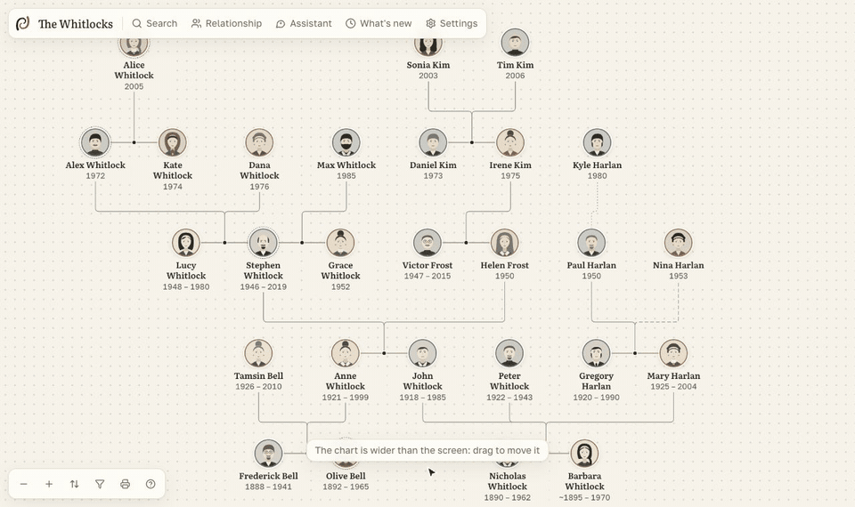

<p align="center">
  <picture>
    <source media="(prefers-color-scheme: dark)" srcset="docs/brand/logo-dark.svg">
    
  </picture>
</p>

# Folkbranch

**Семейное дерево на своём сервере: им может пользоваться вся семья, а ИИ-агенты могут безопасно его дополнять.**

Стройте дерево вместе, заводите для каждого родственника страницу с фото и рассказами и храните всё у себя. Бесплатно, открытый код.

[English version](README.md)



## Установка

Нужен [Docker](https://docs.docker.com/get-docker/). Одна команда:

```bash
curl -fsSL https://raw.githubusercontent.com/danarkhipov/folkbranch/main/install.sh | sh
```

Команда скачает готовый образ и напишет ссылку. Откройте её, назовите семью и, если хотите сначала осмотреться, загрузите демо-семью. Язык приложения определится по браузеру, а поменять его можно на первом экране и в настройках.

На сервере с доменом и автоматическим HTTPS:

```bash
curl -fsSL https://raw.githubusercontent.com/danarkhipov/folkbranch/main/install.sh | sh -s -- --domain family.example.com
```

Или скажите Codex, Claude Code либо другому агенту:

> Установи Folkbranch по инструкции https://raw.githubusercontent.com/danarkhipov/folkbranch/main/skills/folkbranch/SKILL.md

Копии, обновления и Railway описаны в [руководстве на английском](docs/SELF_HOSTING.md).

## Что умеет

- **Дерево:** все поколения на одном экране, подписи родства, поиск пути между двумя людьми, сохранённые виды, печать в PDF.
- **Страницы:** редактор блоков с фото в тексте и ссылками на родных, отметки людей на фото, рассказы голосом и текстом, источники и разные версии дат, объединение дублей.
- **Для всей семьи:** приглашение по ссылке без пароля, роли владельца, редактора и читателя, предложения правок от читателей, ссылка только для просмотра.
- **Данные у вас:** один файл SQLite и папка с фото на вашем сервере, без телеметрии. Живых родственников сервер скрывает от читателей, гостей и агентов только для чтения. Импорт GEDCOM, Excel, CSV, JSON и текста, экспорт GEDCOM и полной копии. Любое изменение можно отменить.
- **ИИ по желанию:** встроенные MCP и REST с токенами, правки агента ждут вашей проверки. Ассистент в приложении работает с вашим ключом OpenRouter, Anthropic, OpenAI или Google.

## Подключить агента

```bash
cd ~/folkbranch && ./folkbranch connect
```

Команда создаст ключ и подключит найденные на компьютере Claude Code или Codex по MCP. Для Cursor, Windsurf и других приложение покажет готовый текст: **Настройки → Агенты и MCP**. Подробнее в [руководстве на английском](docs/AGENTS.md).

## Разработка

```bash
pnpm install && pnpm dev
```

Приложение откроется на http://localhost:3417, данные лежат в `./data`. В `main` то, что выпущено, работа идёт в `develop`. См. [CONTRIBUTING.md](CONTRIBUTING.md). Нашли уязвимость? См. [SECURITY.md](SECURITY.md).

## Лицензия

[AGPL-3.0](LICENSE). Названия и логотипы компаний в приложении принадлежат их владельцам и лишь указывают на сервис.
